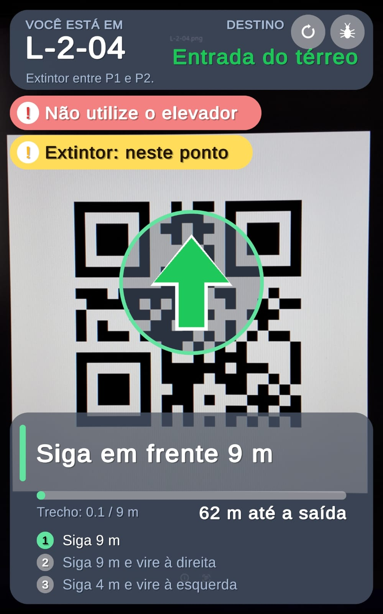

## Visão Geral

O **SafeSight** é um aplicativo Android de Realidade Aumentada que orienta pessoas que não conhecem o prédio até a **saída-alvo** de uma rota segura previamente cadastrada, em uma **simulação controlada de incêndio** (sem fogo ou fumaça reais).

O usuário lê com a câmera o **QR code** de um ponto do corredor. O app identifica o ponto, carrega a rota cadastrada daquele ponto até a saída e, enquanto a pessoa caminha, mostra sobre a imagem da câmera uma **seta, a instrução do trecho, a distância restante, os próximos passos e alertas** (elevador proibido e extintor cadastrado). Entre dois QR codes, a distância percorrida é estimada pelo **rastreamento de movimento do ARCore**. Se o rastreamento se perde ou o trecho é excedido, o app pede uma nova leitura de QR.

A Realidade Aumentada entra como a camada que une a câmera ao vivo, o rastreamento de movimento do ARCore e uma interface de orientação (seta, instruções e alertas) sobreposta à imagem da câmera. Essa interface é fixa na tela e associada ao estado da rota; as indicações não são objetos virtuais ancorados ao piso ou ao ambiente. Tudo funciona **offline**, sem servidor.

## Problema

Placas de saída fixas pressupõem que a pessoa já conhece o prédio. Isso não funciona bem para calouros, visitantes e professores substitutos, principalmente sob estresse. A orientação para a saída segura depende da memória do usuário e de sinalização estática, que não indica por onde ir a partir do ponto em que a pessoa está.

O impacto é a perda de tempo e a possibilidade de escolher um caminho errado durante uma evacuação. O SafeSight propõe uma orientação passo a passo a partir da posição atual do usuário.

## Objetivos

### Objetivo Geral

Desenvolver uma aplicação de Realidade Aumentada que oriente o usuário, por rota cadastrada, até a saída-alvo do Prédio L em uma simulação controlada de incêndio.

### Objetivos Técnicos

- Ler QR codes pela câmera do ARCore (AR Foundation + ZXing.Net) e identificar o ponto atual.
- Carregar a rota cadastrada de cada ponto a partir de um arquivo local (`trajeto.json`).
- Estimar a distância percorrida entre QR codes pelo rastreamento de movimento do ARCore.
- Avisar a aproximação de curvas e pedir novo QR quando o rastreamento é perdido ou o trecho é excedido.
- Exibir um HUD com seta, instrução, distância restante, próximos passos e alertas.
- Executar a aplicação em dispositivo Android e verificar o funcionamento por testes.
