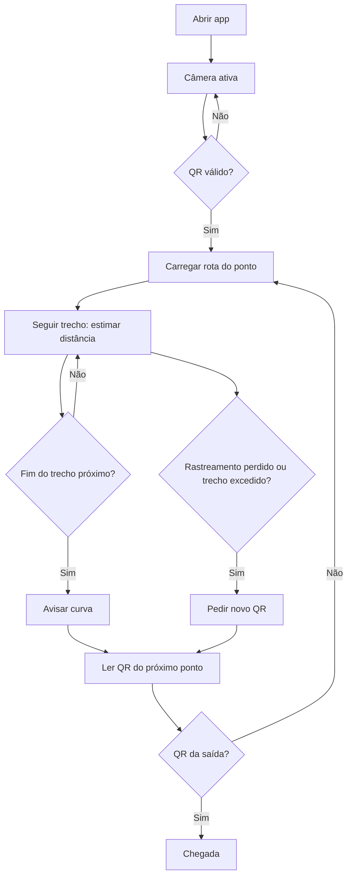

# SafeSight

> **Projeto UPX — Realidade Aumentada (Engenharia da Computação, UniFacens)**
> Orientação por Realidade Aumentada até a saída-alvo em uma simulação controlada de incêndio no Prédio L, a partir de QR codes.


---

## Identificação do Projeto

| Item | Informação |
|---|---|
| **Projeto** | SafeSight |
| **Equipe** | RotAR |
| **Curso** | Engenharia da Computação |
| **Disciplina** | UPX — Realidade Aumentada |
| **Professor** | Daniel Ohata |
| **Semestre** | 8º semestre (2026.2) |
| **Instituição** | UniFacens |

### Integrantes

| Nome | RA | Responsabilidade |
|---|---|---|
| Gustavo Oliveira Gomes | 235413 | Tech Lead: arquitetura, leitura de QR (ZXing.Net), estimativa de deslocamento com ARCore, dados do trajeto (JSON e conversor) e HUD |
| João Victor Cardoso Engler Rizzi de Araujo | 236602 | Lógica de navegação em C#: revisão e correções, testes de regressão (EditMode) e pull request |
| Giulia Oliveira | 210071 | Mapeamento do Prédio L (planilha de pontos e conexões, plantas), pesquisa e QR codes (impressão e validação em campo) |
| Luiz Augusto Marques Zocca | 235623 | Scrum Master: organização e Trello, logística e participação nos testes de campo |
| Henrique Seiji Kuroiwa | 236060 | Pesquisa, artigo científico e documentação |

## Visão Geral

O **SafeSight** é um aplicativo Android de Realidade Aumentada que orienta pessoas que não conhecem o prédio até a **saída-alvo** de uma rota segura previamente cadastrada, em uma **simulação controlada de incêndio** (sem fogo ou fumaça reais).

O usuário lê com a câmera o **QR code** de um ponto do corredor. O app identifica o ponto, carrega a rota cadastrada daquele ponto até a saída e, enquanto a pessoa caminha, mostra sobre a imagem da câmera uma **seta, a instrução do trecho, a distância restante, os próximos passos e alertas** (elevador proibido e extintor cadastrado). Entre dois QR codes, a distância percorrida é estimada pelo **rastreamento de movimento do ARCore**. Se o rastreamento se perde ou o trecho é excedido, o app pede uma nova leitura de QR.

A Realidade Aumentada entra como a camada que une a câmera ao vivo, o rastreamento de movimento do ARCore e uma interface de orientação (seta, instruções e alertas) sobreposta à imagem da câmera. Essa interface é fixa na tela e associada ao estado da rota; as indicações não são objetos virtuais ancorados ao piso ou ao ambiente. Tudo funciona **offline**, sem servidor.


## Problema

Placas de saída fixas pressupõem que a pessoa já conhece o prédio. Isso não funciona bem para calouros, visitantes e professores substitutos, principalmente sob estresse. A orientação para a saída segura depende da memória do usuário e de sinalização estática, que não indica por onde ir a partir do ponto em que a pessoa está.

O impacto é a perda de tempo e a possibilidade de escolher um caminho errado durante uma evacuação. O SafeSight propõe uma orientação passo a passo a partir da posição atual do usuário.

## Objetivos

### Objetivo Geral

Desenvolver uma aplicação de Realidade Aumentada que oriente o usuário, por rota cadastrada, até a saída-alvo do Prédio L em uma simulação controlada de incêndio.

### Objetivos Técnicos

- Ler QR codes pela câmera do ARCore (AR Foundation + ZXing.Net) e identificar o ponto atual.
- Carregar a rota cadastrada de cada ponto a partir de um arquivo local (`trajeto.json`).
- Estimar a distância percorrida entre QR codes pelo rastreamento de movimento do ARCore.
- Avisar a aproximação de curvas e pedir novo QR quando o rastreamento é perdido ou o trecho é excedido.
- Exibir um HUD com seta, instrução, distância restante, próximos passos e alertas.
- Executar a aplicação em dispositivo Android e verificar o funcionamento por testes.

## Público-Alvo

Pessoas que não conhecem o Prédio L da UniFacens: calouros, visitantes e professores substitutos. O uso ocorre em simulação de incêndio, em movimento e com pouca atenção disponível para a tela; por isso o HUD usa texto grande, poucas informações e nenhum menu.

- **Familiaridade tecnológica:** pressupõe-se apenas o uso básico de um smartphone ou tablet (abrir o app e autorizar a câmera); não há cadastro nem configuração.
- **Necessidades:** saber para onde ir a partir do ponto onde está, a cada trecho, e ser avisado da curva e do elevador proibido.
- **Limitações do uso:** o app depende de o usuário encontrar e ler os QR codes e de o dispositivo ter suporte ao ARCore; o experimento com usuários ainda não foi executado.

## Funcionalidades

| ID | Funcionalidade | Descrição | Status |
|---|---|---|---|
| RF01 | Exibir câmera com seta e instruções | Imagem da câmera ao vivo com seta e instruções sobrepostas | ✅ |
| RF02 | Ler QR code | Lê o ID do ponto pela câmera do ARCore | ✅ |
| RF03 | Definir posição e carregar rota | Valida o ID e carrega a rota cadastrada do ponto; nova leitura a qualquer momento | ✅ |
| RF04 | Orientar até a saída-alvo | Segue a rota cadastrada, trecho a trecho, sem elevador | ✅ |
| RF05 | Identificar a saída-alvo | Mostra o destino na tela | ✅ |
| RF06 | Instrução, próximos passos, distância e chegada | Instrução atual, próximos passos, distância restante; chegada ao ler o QR da saída | ✅ |
| RF07 | Alertas | "Não utilize o elevador" e extintor cadastrado do ponto atual | ✅ |
| RF08 | Estimar distância entre QR codes | Distância percorrida pelo rastreamento de movimento do ARCore | ✅ |
| RF09 | Avisar curva | Avisa a aproximação da curva (cerca de 1 m do fim do trecho) | ✅ |
| RF10 | Pedir novo QR | Pede nova leitura se o rastreamento é perdido ou o trecho é excedido | ✅ |

**Legenda:** ✅ Implementado · 🚧 Em desenvolvimento · ⬜ Planejado · ❌ Cancelado

## Requisitos Não Funcionais

| ID | Categoria | Requisito |
|---|---|---|
| RNF01 | Conectividade | Funcionar offline, sem servidor |
| RNF02 | Compatibilidade | Executar em Android com suporte ao ARCore |
| RNF03 | Usabilidade | Interface legível, com texto grande e sem menus |
| RNF04 | Desempenho | Ler QR sem comprometer a fluidez (30 fps ou mais) |
| RNF05 | Infraestrutura | Não depender de nada além dos QR codes impressos |

## Tecnologias Utilizadas

| Tecnologia | Versão | Utilização |
|---|---|---|
| Unity | 6000.3.25f1 (6.3 LTS) | Desenvolvimento principal (template 3D, URP) |
| C# | compatível com Unity 6 | Scripts da aplicação |
| AR Foundation | 6.3.5 | Camada de abstração de RA |
| Google ARCore XR Plugin | 6.3.5 | Rastreamento de movimento e câmera em Android |
| ZXing.Net | 0.16.11 | Decodificação de QR codes |
| NuGetForUnity | pacote Git (GlitchEnzo/NuGetForUnity, `src/NuGetForUnity`) | Instalação do ZXing.Net |
| Unity Test Framework (NUnit) | 1.6.0 | Testes automatizados (EditMode) |
| Universal Render Pipeline (URP) | 17.3.0 | Pipeline gráfico |
| Input System | 1.20.0 | Entrada (novo Input System) |
| XR Plugin Management | 4.6.1 | Carregamento do ARCore no Android |
| Python 3.13 e openpyxl 3.1.5 | versões do ambiente em que os scripts foram executados (25/10); na máquina do Tech Lead há Python 3.12.7 (sem openpyxl instalado) | Conversor planilha→JSON (`Assets/tools/gerar_trajeto.py`) |
| OpenCV (Python) 5.0.0, NumPy 2.5.3 e ReportLab 5.0.1 | mesmo ambiente de execução (Python 3.13, 25/10) | Geração e validação dos QR codes e do PDF de impressão (`Assets/tools/gerar_qrcodes.py`, escrito com apoio de IA) |
| Git e GitHub | — | Controle de versão e hospedagem |

## Hardware Utilizado

| Equipamento | Modelo | Característica relevante | Utilização |
|---|---|---|---|
| Tablet | Samsung Galaxy Tab S9 FE | Android 16 / One UI 8 | Build e verificação do HUD |
| Celular | Samsung Galaxy M54 5G | Android 16 / One UI 8 | Testes de deslocamento e avisos |
| Celular | Samsung Galaxy A54 5G | Android 16 / One UI 8 | Testes de deslocamento e avisos |
| Computador | Notebook com Intel Core i7-9750H 2,60 GHz, 32 GB DDR4, Intel UHD Graphics 630 e NVIDIA GeForce GTX 1660 Ti (6 GB) | CPU, RAM e GPU | Desenvolvimento (Gustavo) |
| Computador | Notebook com Intel Core i7-1165G7 2,80 GHz, 8 GB de RAM e Intel Iris Xe Graphics | CPU, RAM e GPU | Desenvolvimento (João) |

> Foram usados apenas os três aparelhos acima. Nenhuma compatibilidade foi declarada para outros equipamentos.

## Arquitetura do Sistema

O app é 100% Unity e roda localmente. O `QrScanner` lê o QR; o `NavigationController` liga leitura, estimativa de deslocamento e lógica; a `NavigationLogic` (sem dependência de ARCore, testável isoladamente) decide o estado a partir das rotas do `trajeto.json`; o `NavigationHud` desenha a interface.


### Fluxo resumido

```text
Usuário → Câmera (ARCore) → QrScanner → NavigationController → NavigationLogic (trajeto.json)
                                    ↘ DisplacementEstimator (pose do ARCore) ↗
NavigationLogic → NavigationHud → Seta, instruções e alertas sobre a câmera
```

## Funcionamento da Realidade Aumentada

### Técnica utilizada

**QR Code como referência de posição, mais rastreamento de movimento do ARCore (odometria visual-inercial).** O QR só informa a posição no instante da leitura (o ZXing.Net decodifica o texto, sem pose). Entre dois QR codes, a distância é estimada pela pose do dispositivo fornecida pelo ARCore. A seta e as instruções são um **HUD fixo na tela**, não ancorado ao piso.

### Fluxo técnico


1. A câmera do ARCore é iniciada pelo AR Foundation.
2. O `QrScanner` obtém o frame (`XRCpuImage`), copia o plano de luminância e o decodifica com o ZXing.Net, a cada 5 frames.
3. O ID lido é validado contra os pontos do `trajeto.json`; a rota cadastrada do ponto é carregada.
4. O `DisplacementEstimator` guarda a pose inicial e acompanha a pose da câmera no plano horizontal: distância em linha reta, caminho acumulado e giro.
5. A `NavigationLogic` compara a distância com o comprimento do trecho: segue, avisa a curva (a cerca de 1 m do fim), pede novo QR (rastreamento perdido ou 1,5 m além do trecho) ou informa a chegada (QR da saída).
6. O `NavigationHud` mostra seta, instrução, distância restante, próximos passos e alertas sobre a imagem da câmera.
7. Ao ler o QR do próximo ponto, a estimativa reinicia e a rota seguinte é carregada.

### Estados da navegação


### Elementos virtuais

> Os elementos abaixo são uma interface sobreposta ao vídeo da câmera (HUD), controlada pelo estado da navegação. Não há ancoragem tridimensional ao piso nem aos elementos do ambiente; o ARCore é usado para estimar o deslocamento.

- seta de direção (gira à direita ou à esquerda na curva);
- instrução do trecho atual e lista dos próximos passos;
- barra de progresso do trecho e distância até a saída;
- alertas de elevador e de extintor;
- estados: aguardando QR, rota ativa, novo QR necessário, QR inválido e chegada.

## Estrutura do Projeto

```text
safesight/
├── Assets/
│   ├── Resources/
│   │   └── trajeto.json          # pontos e rotas do Prédio L
│   ├── Scenes/
│   │   └── ARTest.unity          # cena principal
│   ├── Packages/
│   │   └── ZXing.Net.0.16.11/    # biblioteca de QR (NuGet, versionada)
│   ├── Scripts/
│   │   ├── Navigation/           # lógica de navegação (sem MonoBehaviour)
│   │   ├── QrScanner.cs
│   │   ├── DisplacementEstimator.cs
│   │   ├── NavigationController.cs
│   │   └── NavigationHud.cs
│   ├── Tests/EditMode/           # testes automatizados
│   └── tools/
│       ├── gerar_trajeto.py      # conversor planilha → JSON
│       └── gerar_qrcodes.py      # gerador e validador dos QR codes
├── Packages/
├── ProjectSettings/
├── docs/
│   ├── Mapeamento_Predio_L_todos_andares.xlsx
│   ├── diagrams/                 # diagramas (.png e fonte .mmd)
│   ├── documents/                # documentos complementares
│   └── images/                   # prints do aplicativo
├── .gitignore
└── README.md
```

> Árvore conferida com o repositório em 31/10. Pastas geradas pelo Unity (`Library`, `Temp`, `Logs`, `UserSettings`) e os builds são ignorados pelo `.gitignore`.

| Pasta | Finalidade |
|---|---|
| `Assets/Scripts` | Scripts produzidos pela equipe |
| `Assets/Scripts/Navigation` | Lógica de navegação e dados do trajeto (assembly `SafeSight.Navigation`) |
| `Assets/Resources/trajeto.json` | Pontos e rotas cadastradas do Prédio L |
| `Assets/Tests/EditMode` | Testes automatizados da navegação |
| `Assets/tools` | Conversor da planilha de mapeamento para JSON e gerador/validador dos QR codes |
| `Assets/Packages` | ZXing.Net 0.16.11 (NuGet), versionado |
| `docs/diagrams` | Diagramas técnicos |
| `docs/images` | Screenshots do aplicativo |
| `docs/documents` | Documentos complementares (`validacao_qrcodes.txt`: resultado da geração e validação dos QR codes) |

## Principais Scripts

| Script | Responsabilidade |
|---|---|
| `QrScanner.cs` | Obtém o frame da câmera do ARCore, decodifica o QR com ZXing.Net e dispara o evento de leitura |
| `DisplacementEstimator.cs` | Estima distância em linha reta, caminho e giro a partir da pose do ARCore; reinicia a cada QR |
| `NavigationLogic.cs` | Regras de navegação: rota do ponto, estados, alertas, distância restante e instruções |
| `TrajectoryData.cs` | Estrutura dos dados do `trajeto.json` (pontos, rotas e trechos) |
| `NavigationController.cs` | Liga leitura de QR, estimativa de deslocamento e lógica; avisos de QR inválido |
| `NavigationHud.cs` | Desenha o HUD (IMGUI): seta, instrução, progresso, próximos passos e alertas |
| `NavigationLogicTests.cs`, `NavigationRotasReaisTests.cs` | Testes automatizados com as rotas reais |

## Dependências

```text
AR Foundation 6.3.5
Google ARCore XR Plugin 6.3.5
XR Plugin Management 4.6.1
ZXing.Net 0.16.11 (via NuGetForUnity)
NuGetForUnity (pacote Git)
Unity Test Framework 1.6.0
Universal Render Pipeline 17.3.0
Input System 1.20.0
```

**Onde obter:** AR Foundation, ARCore XR Plugin, XR Plugin Management, Input System, URP e Test Framework vêm do Unity Package Manager. O ZXing.Net 0.16.11 é obtido no [NuGet](https://www.nuget.org/packages/ZXing.Net/0.16.11) (código em [micjahn/ZXing.Net](https://github.com/micjahn/ZXing.Net)) e o NuGetForUnity em [GlitchEnzo/NuGetForUnity](https://github.com/GlitchEnzo/NuGetForUnity).

Versões conferidas em `Packages/manifest.json` e `Packages/packages-lock.json`. O ZXing.Net 0.16.11 está **versionado no repositório** (`Assets/Packages/ZXing.Net.0.16.11/`, com `Assets/NuGet.config` e `Assets/packages.config`), então não é preciso restaurá-lo manualmente.

## Configuração do Ambiente

### Pré-requisitos

- Windows 10 ou 11;
- Unity Hub e Unity **6000.3.25f1** com o módulo **Android Build Support** (SDK, NDK e OpenJDK pelo Hub);
- Git;
- tablet ou smartphone Android com suporte ao ARCore e depuração USB ativada.

### Procedimento

1. Instale o Unity Hub.
2. Instale o Unity 6000.3.25f1 com Android Build Support.
3. Instale o Git.
4. Clone o repositório.
5. Abra o projeto pelo Unity Hub (aguarde a importação).
6. O ZXing.Net já acompanha o repositório (`Assets/Packages`); se o Unity avisar de pacote ausente, abra **NuGet → Restore Packages**.
7. Em Build Profiles, selecione Android.

## Como Executar

```bash
git clone https://github.com/UPX08-RA/safesight.git
cd safesight
```

1. Abra o Unity Hub e clique em **Add / Open Project**.
2. Selecione a pasta clonada e confirme a versão 6000.3.25f1.
3. Abra a cena `Assets/Scenes/ARTest.unity`.
4. Em **Build Profiles**, selecione **Android**.
5. Conecte o dispositivo por USB.
6. Execute **Build and Run**.

## Como Utilizar a Aplicação

1. Abra o SafeSight no dispositivo e autorize o acesso à câmera.
2. Aponte a câmera para o QR code de um ponto do corredor (a cerca de 30 cm).
3. Leia a instrução e siga a seta. A barra mostra o avanço do trecho e o texto, a distância até a saída.
4. Perto da curva, a seta gira para o lado indicado.
5. No fim do trecho, leia o QR code do próximo ponto.
6. Se aparecer o "?", leia o próximo QR code para retomar.
7. Ao ler o QR da saída, aparece a confirmação de chegada.

Os botões **Reiniciar** e **Debug** ficam no topo da tela.


## Fluxo de Funcionamento



## Caso de Uso

O usuário (pessoa que evacua) lê o QR, acompanha as instruções e lê o próximo QR até a saída. Não há administrador nem servidor no escopo.

---

## Fluxo de Navegação

```text
Câmera (aguardando QR)
    ↓ lê QR
Rota ativa (seta, instrução, progresso, próximos passos)
    ↓ fim do trecho → lê QR do próximo ponto
Rota ativa (próximo trecho)
    ↓ ... até ler o QR da saída
Chegada
```

Não há tela inicial separada: o app abre direto na câmera, pois o uso ocorre em situação de pressa.

## Interface

Telas atuais (HUD sobre a câmera), capturadas no aplicativo em 29/10, com os QR codes exibidos em um monitor.

| Tela | Finalidade | Principais elementos | Ação do usuário |
|---|---|---|---|
| Aguardando QR (`hud_idle.jpeg`) | Pedir a leitura do primeiro QR | Moldura de leitura e instrução "Aponte a câmera para um QR Code para começar" | Aponta a câmera para um QR code do corredor |
| Rota ativa (`hud_rota.jpeg`) | Orientar o trecho atual | "Você está em" / destino, seta, instrução, barra de progresso, próximos passos e alertas | Caminha seguindo a seta e as instruções |
| Aviso de curva (`hud_curva.jpeg`) | Avisar a curva próxima | Seta girada e em âmbar, com a distância até a curva | Prepara-se para virar para o lado indicado |
| Novo QR (`hud_novo_qr.jpeg`) | Pedir nova leitura | "?" em vermelho e mensagem de posição incerta | Lê o QR code do próximo ponto |
| QR inválido (`hud_qr_invalido.jpeg`) | Informar QR não reconhecido | Aviso temporário "QR não reconhecido" | Lê um QR code do projeto |
| Chegada (`hud_chegada.jpeg`) | Informar a chegada | Check em verde e confirmação de chegada | Encerra a rota |

<p>


</p>
<p>


</p>

---|---|---|
| Aguardando QR (`hud_idle.jpeg`) | Pedir a leitura do primeiro QR | Moldura de leitura |
| Rota ativa (`hud_rota.jpeg`) | Orientar o trecho atual | Você está em / destino, seta, instrução, barra, próximos passos, alertas |
| Aviso de curva (`hud_curva.jpeg`) | Avisar a curva próxima | Seta girada e em âmbar |
| Novo QR (`hud_novo_qr.jpeg`) | Pedir nova leitura | "?" em vermelho |
| QR inválido (`hud_qr_invalido.jpeg`) | Informar QR não reconhecido | Aviso temporário |
| Chegada (`hud_chegada.jpeg`) | Informar a chegada | Check em verde |


