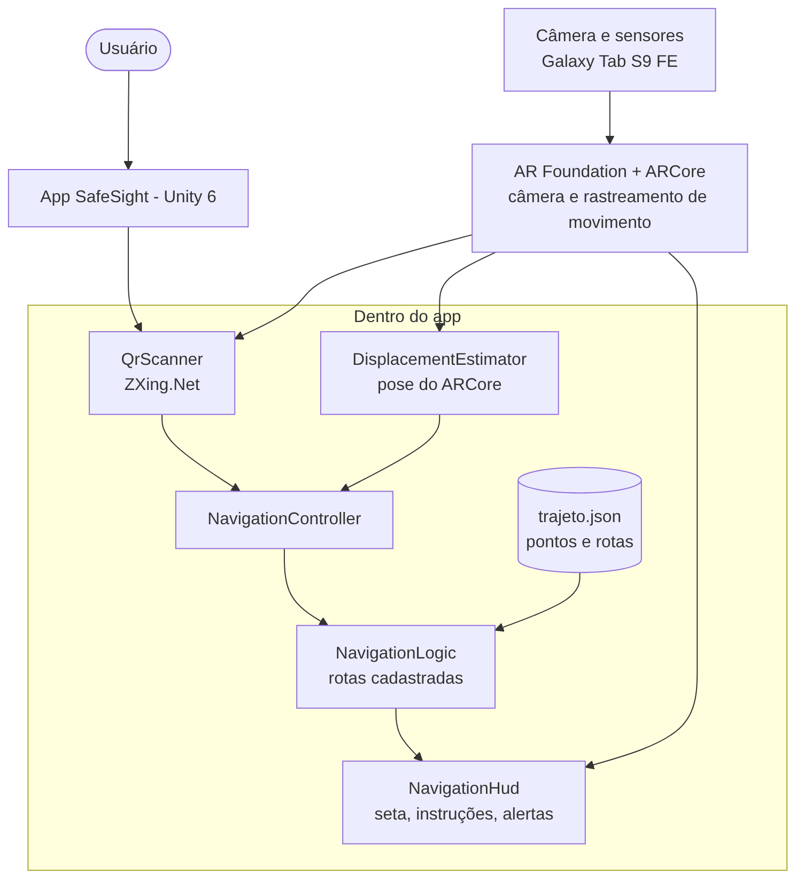
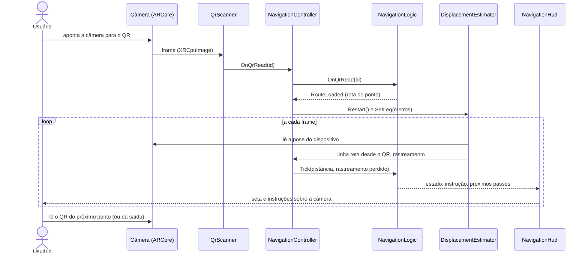
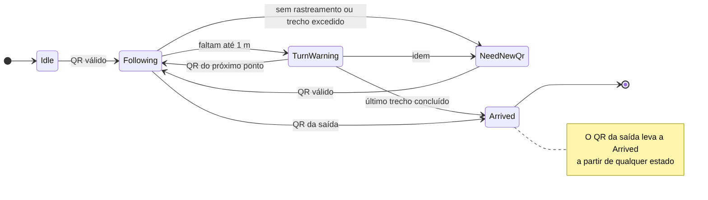
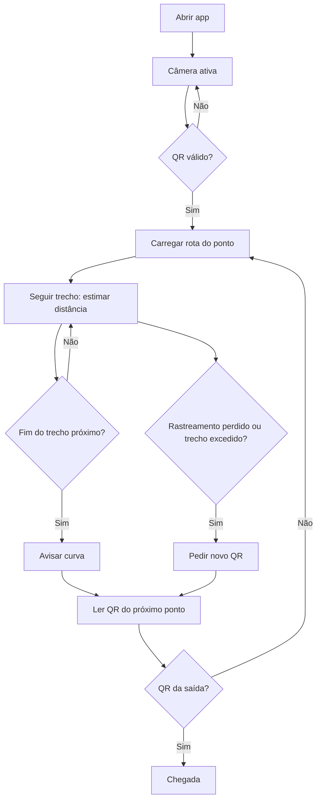
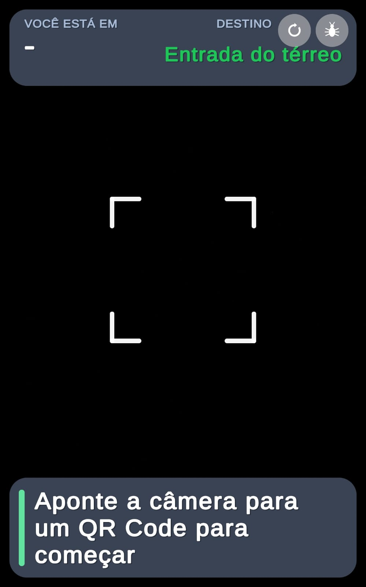
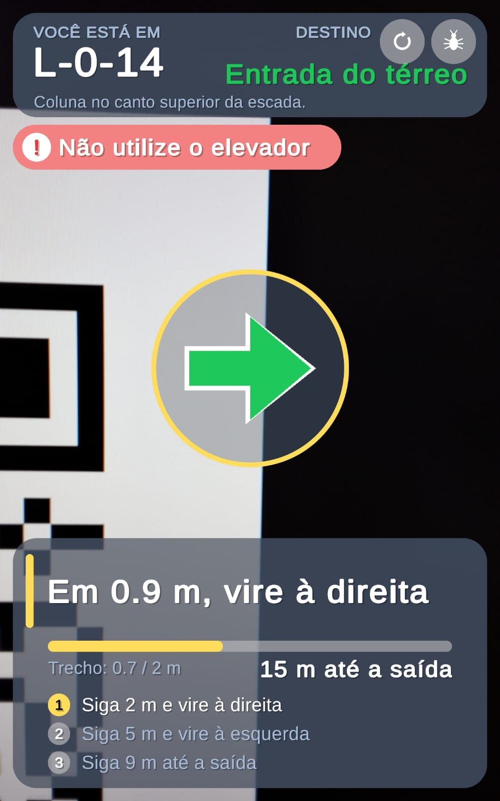
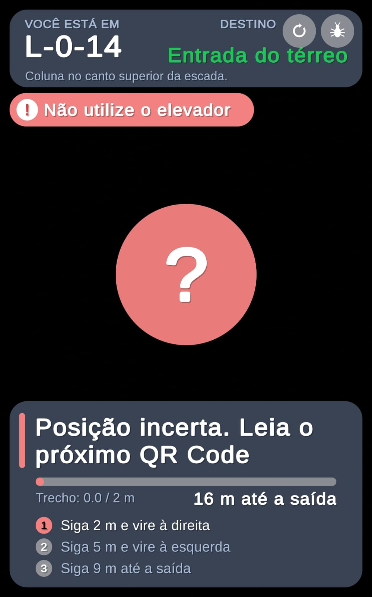
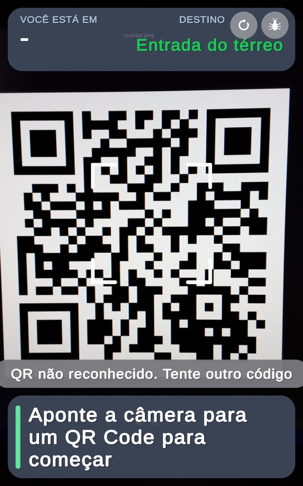
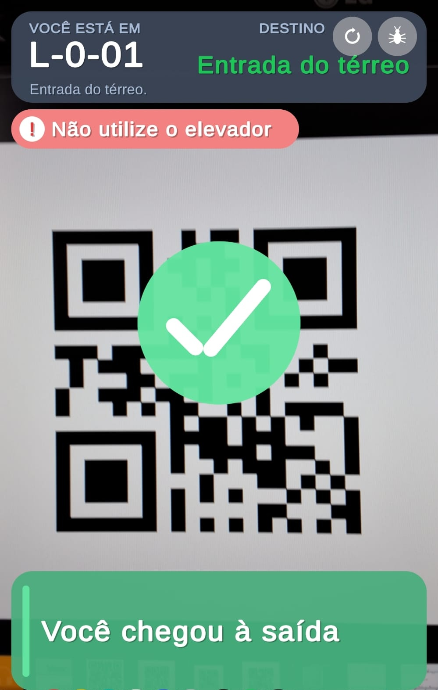

# SafeSight

> **Projeto UPX — Realidade Aumentada (Engenharia da Computação, UniFacens)**
> Orientação por Realidade Aumentada até a saída-alvo em uma simulação controlada de incêndio no Prédio L, a partir de QR codes.


---

## Identificação do Projeto

| Item | Informação |
|---|---|
| **Projeto** | SafeSight |
| **Equipe** | RotAR |
| **Curso** | Engenharia da Computação |
| **Disciplina** | UPX — Realidade Aumentada |
| **Professor** | Daniel Ohata |
| **Semestre** | 8º semestre (2026.2) |
| **Instituição** | UniFacens |

### Integrantes

| Nome | RA | Responsabilidade |
|---|---|---|
| Gustavo Oliveira Gomes | 235413 | Tech Lead: arquitetura, leitura de QR (ZXing.Net), estimativa de deslocamento com ARCore, dados do trajeto (JSON e conversor) e HUD |
| João Victor Cardoso Engler Rizzi de Araujo | 236602 | Lógica de navegação em C#: revisão e correções, testes de regressão (EditMode) e pull request |
| Giulia Oliveira | 210071 | Mapeamento do Prédio L (planilha de pontos e conexões, plantas), pesquisa e QR codes (impressão e validação em campo) |
| Luiz Augusto Marques Zocca | 235623 | Scrum Master: organização e Trello, logística e participação nos testes de campo |
| Henrique Seiji Kuroiwa | 236060 | Pesquisa, artigo científico e documentação |

## Visão Geral

O **SafeSight** é um aplicativo Android de Realidade Aumentada que orienta pessoas que não conhecem o prédio até a **saída-alvo** de uma rota segura previamente cadastrada, em uma **simulação controlada de incêndio** (sem fogo ou fumaça reais).

O usuário lê com a câmera o **QR code** de um ponto do corredor. O app identifica o ponto, carrega a rota cadastrada daquele ponto até a saída e, enquanto a pessoa caminha, mostra sobre a imagem da câmera uma **seta, a instrução do trecho, a distância restante, os próximos passos e alertas** (elevador proibido e extintor cadastrado). Entre dois QR codes, a distância percorrida é estimada pelo **rastreamento de movimento do ARCore**. Se o rastreamento se perde ou o trecho é excedido, o app pede uma nova leitura de QR.

A Realidade Aumentada entra como a camada que une a câmera ao vivo, o rastreamento de movimento do ARCore e uma interface de orientação (seta, instruções e alertas) sobreposta à imagem da câmera. Essa interface é fixa na tela e associada ao estado da rota; as indicações não são objetos virtuais ancorados ao piso ou ao ambiente. Tudo funciona **offline**, sem servidor.


## Problema

Placas de saída fixas pressupõem que a pessoa já conhece o prédio. Isso não funciona bem para calouros, visitantes e professores substitutos, principalmente sob estresse. A orientação para a saída segura depende da memória do usuário e de sinalização estática, que não indica por onde ir a partir do ponto em que a pessoa está.

O impacto é a perda de tempo e a possibilidade de escolher um caminho errado durante uma evacuação. O SafeSight propõe uma orientação passo a passo a partir da posição atual do usuário.

## Objetivos

### Objetivo Geral

Desenvolver uma aplicação de Realidade Aumentada que oriente o usuário, por rota cadastrada, até a saída-alvo do Prédio L em uma simulação controlada de incêndio.

### Objetivos Técnicos

- Ler QR codes pela câmera do ARCore (AR Foundation + ZXing.Net) e identificar o ponto atual.
- Carregar a rota cadastrada de cada ponto a partir de um arquivo local (`trajeto.json`).
- Estimar a distância percorrida entre QR codes pelo rastreamento de movimento do ARCore.
- Avisar a aproximação de curvas e pedir novo QR quando o rastreamento é perdido ou o trecho é excedido.
- Exibir um HUD com seta, instrução, distância restante, próximos passos e alertas.
- Executar a aplicação em dispositivo Android e verificar o funcionamento por testes.

## Público-Alvo

Pessoas que não conhecem o Prédio L da UniFacens: calouros, visitantes e professores substitutos. O uso ocorre em simulação de incêndio, em movimento e com pouca atenção disponível para a tela; por isso o HUD usa texto grande, poucas informações e nenhum menu.

- **Familiaridade tecnológica:** pressupõe-se apenas o uso básico de um smartphone ou tablet (abrir o app e autorizar a câmera); não há cadastro nem configuração.
- **Necessidades:** saber para onde ir a partir do ponto onde está, a cada trecho, e ser avisado da curva e do elevador proibido.
- **Limitações do uso:** o app depende de o usuário encontrar e ler os QR codes e de o dispositivo ter suporte ao ARCore; o experimento com usuários ainda não foi executado.

## Funcionalidades

| ID | Funcionalidade | Descrição | Status |
|---|---|---|---|
| RF01 | Exibir câmera com seta e instruções | Imagem da câmera ao vivo com seta e instruções sobrepostas | ✅ |
| RF02 | Ler QR code | Lê o ID do ponto pela câmera do ARCore | ✅ |
| RF03 | Definir posição e carregar rota | Valida o ID e carrega a rota cadastrada do ponto; nova leitura a qualquer momento | ✅ |
| RF04 | Orientar até a saída-alvo | Segue a rota cadastrada, trecho a trecho, sem elevador | ✅ |
| RF05 | Identificar a saída-alvo | Mostra o destino na tela | ✅ |
| RF06 | Instrução, próximos passos, distância e chegada | Instrução atual, próximos passos, distância restante; chegada ao ler o QR da saída | ✅ |
| RF07 | Alertas | "Não utilize o elevador" e extintor cadastrado do ponto atual | ✅ |
| RF08 | Estimar distância entre QR codes | Distância percorrida pelo rastreamento de movimento do ARCore | ✅ |
| RF09 | Avisar curva | Avisa a aproximação da curva (cerca de 1 m do fim do trecho) | ✅ |
| RF10 | Pedir novo QR | Pede nova leitura se o rastreamento é perdido ou o trecho é excedido | ✅ |

**Legenda:** ✅ Implementado · 🚧 Em desenvolvimento · ⬜ Planejado · ❌ Cancelado

## Requisitos Não Funcionais

| ID | Categoria | Requisito |
|---|---|---|
| RNF01 | Conectividade | Funcionar offline, sem servidor |
| RNF02 | Compatibilidade | Executar em Android com suporte ao ARCore |
| RNF03 | Usabilidade | Interface legível, com texto grande e sem menus |
| RNF04 | Desempenho | Ler QR sem comprometer a fluidez (30 fps ou mais) |
| RNF05 | Infraestrutura | Não depender de nada além dos QR codes impressos |

## Tecnologias Utilizadas

| Tecnologia | Versão | Utilização |
|---|---|---|
| Unity | 6000.3.25f1 (6.3 LTS) | Desenvolvimento principal (template 3D, URP) |
| C# | compatível com Unity 6 | Scripts da aplicação |
| AR Foundation | 6.3.5 | Camada de abstração de RA |
| Google ARCore XR Plugin | 6.3.5 | Rastreamento de movimento e câmera em Android |
| ZXing.Net | 0.16.11 | Decodificação de QR codes |
| NuGetForUnity | pacote Git (GlitchEnzo/NuGetForUnity, `src/NuGetForUnity`) | Instalação do ZXing.Net |
| Unity Test Framework (NUnit) | 1.6.0 | Testes automatizados (EditMode) |
| Universal Render Pipeline (URP) | 17.3.0 | Pipeline gráfico |
| Input System | 1.20.0 | Entrada (novo Input System) |
| XR Plugin Management | 4.6.1 | Carregamento do ARCore no Android |
| Python 3.13 e openpyxl 3.1.5 | versões do ambiente em que os scripts foram executados (25/10); na máquina do Tech Lead há Python 3.12.7 (sem openpyxl instalado) | Conversor planilha→JSON (`Assets/tools/gerar_trajeto.py`) |
| OpenCV (Python) 5.0.0, NumPy 2.5.3 e ReportLab 5.0.1 | mesmo ambiente de execução (Python 3.13, 25/10) | Geração e validação dos QR codes e do PDF de impressão (`Assets/tools/gerar_qrcodes.py`, escrito com apoio de IA) |
| Git e GitHub | — | Controle de versão e hospedagem |

## Hardware Utilizado

| Equipamento | Modelo | Característica relevante | Utilização |
|---|---|---|---|
| Tablet | Samsung Galaxy Tab S9 FE | Android 16 / One UI 8 | Build e verificação do HUD |
| Celular | Samsung Galaxy M54 5G | Android 16 / One UI 8 | Testes de deslocamento e avisos |
| Celular | Samsung Galaxy A54 5G | Android 16 / One UI 8 | Testes de deslocamento e avisos |
| Computador | Notebook com Intel Core i7-9750H 2,60 GHz, 32 GB DDR4, Intel UHD Graphics 630 e NVIDIA GeForce GTX 1660 Ti (6 GB) | CPU, RAM e GPU | Desenvolvimento (Gustavo) |
| Computador | Notebook com Intel Core i7-1165G7 2,80 GHz, 8 GB de RAM e Intel Iris Xe Graphics | CPU, RAM e GPU | Desenvolvimento (João) |

> Foram usados apenas os três aparelhos acima. Nenhuma compatibilidade foi declarada para outros equipamentos.

## Arquitetura do Sistema

O app é 100% Unity e roda localmente. O `QrScanner` lê o QR; o `NavigationController` liga leitura, estimativa de deslocamento e lógica; a `NavigationLogic` (sem dependência de ARCore, testável isoladamente) decide o estado a partir das rotas do `trajeto.json`; o `NavigationHud` desenha a interface.



### Fluxo resumido

```text
Usuário → Câmera (ARCore) → QrScanner → NavigationController → NavigationLogic (trajeto.json)
                                    ↘ DisplacementEstimator (pose do ARCore) ↗
NavigationLogic → NavigationHud → Seta, instruções e alertas sobre a câmera
```

## Funcionamento da Realidade Aumentada

### Técnica utilizada

**QR Code como referência de posição, mais rastreamento de movimento do ARCore (odometria visual-inercial).** O QR só informa a posição no instante da leitura (o ZXing.Net decodifica o texto, sem pose). Entre dois QR codes, a distância é estimada pela pose do dispositivo fornecida pelo ARCore. A seta e as instruções são um **HUD fixo na tela**, não ancorado ao piso.

### Fluxo técnico



1. A câmera do ARCore é iniciada pelo AR Foundation.
2. O `QrScanner` obtém o frame (`XRCpuImage`), copia o plano de luminância e o decodifica com o ZXing.Net, a cada 5 frames.
3. O ID lido é validado contra os pontos do `trajeto.json`; a rota cadastrada do ponto é carregada.
4. O `DisplacementEstimator` guarda a pose inicial e acompanha a pose da câmera no plano horizontal: distância em linha reta, caminho acumulado e giro.
5. A `NavigationLogic` compara a distância com o comprimento do trecho: segue, avisa a curva (a cerca de 1 m do fim), pede novo QR (rastreamento perdido ou 1,5 m além do trecho) ou informa a chegada (QR da saída).
6. O `NavigationHud` mostra seta, instrução, distância restante, próximos passos e alertas sobre a imagem da câmera.
7. Ao ler o QR do próximo ponto, a estimativa reinicia e a rota seguinte é carregada.

### Estados da navegação



### Elementos virtuais

> Os elementos abaixo são uma interface sobreposta ao vídeo da câmera (HUD), controlada pelo estado da navegação. Não há ancoragem tridimensional ao piso nem aos elementos do ambiente; o ARCore é usado para estimar o deslocamento.

- seta de direção (gira à direita ou à esquerda na curva);
- instrução do trecho atual e lista dos próximos passos;
- barra de progresso do trecho e distância até a saída;
- alertas de elevador e de extintor;
- estados: aguardando QR, rota ativa, novo QR necessário, QR inválido e chegada.

## Estrutura do Projeto

```text
safesight/
├── Assets/
│   ├── Resources/
│   │   └── trajeto.json          # pontos e rotas do Prédio L
│   ├── Scenes/
│   │   └── ARTest.unity          # cena principal
│   ├── Packages/
│   │   └── ZXing.Net.0.16.11/    # biblioteca de QR (NuGet, versionada)
│   ├── Scripts/
│   │   ├── Navigation/           # lógica de navegação (sem MonoBehaviour)
│   │   ├── QrScanner.cs
│   │   ├── DisplacementEstimator.cs
│   │   ├── NavigationController.cs
│   │   └── NavigationHud.cs
│   ├── Tests/EditMode/           # testes automatizados
│   └── tools/
│       ├── gerar_trajeto.py      # conversor planilha → JSON
│       └── gerar_qrcodes.py      # gerador e validador dos QR codes
├── Packages/
├── ProjectSettings/
├── docs/
│   ├── Mapeamento_Predio_L_todos_andares.xlsx
│   ├── diagrams/                 # diagramas (.png e fonte .mmd)
│   ├── documents/                # documentos complementares
│   └── images/                   # prints do aplicativo
├── .gitignore
└── README.md
```

> Árvore conferida com o repositório em 31/10. Pastas geradas pelo Unity (`Library`, `Temp`, `Logs`, `UserSettings`) e os builds são ignorados pelo `.gitignore`.

| Pasta | Finalidade |
|---|---|
| `Assets/Scripts` | Scripts produzidos pela equipe |
| `Assets/Scripts/Navigation` | Lógica de navegação e dados do trajeto (assembly `SafeSight.Navigation`) |
| `Assets/Resources/trajeto.json` | Pontos e rotas cadastradas do Prédio L |
| `Assets/Tests/EditMode` | Testes automatizados da navegação |
| `Assets/tools` | Conversor da planilha de mapeamento para JSON e gerador/validador dos QR codes |
| `Assets/Packages` | ZXing.Net 0.16.11 (NuGet), versionado |
| `docs/diagrams` | Diagramas técnicos |
| `docs/images` | Screenshots do aplicativo |
| `docs/documents` | Documentos complementares (`validacao_qrcodes.txt`: resultado da geração e validação dos QR codes) |

## Principais Scripts

| Script | Responsabilidade |
|---|---|
| `QrScanner.cs` | Obtém o frame da câmera do ARCore, decodifica o QR com ZXing.Net e dispara o evento de leitura |
| `DisplacementEstimator.cs` | Estima distância em linha reta, caminho e giro a partir da pose do ARCore; reinicia a cada QR |
| `NavigationLogic.cs` | Regras de navegação: rota do ponto, estados, alertas, distância restante e instruções |
| `TrajectoryData.cs` | Estrutura dos dados do `trajeto.json` (pontos, rotas e trechos) |
| `NavigationController.cs` | Liga leitura de QR, estimativa de deslocamento e lógica; avisos de QR inválido |
| `NavigationHud.cs` | Desenha o HUD (IMGUI): seta, instrução, progresso, próximos passos e alertas |
| `NavigationLogicTests.cs`, `NavigationRotasReaisTests.cs` | Testes automatizados com as rotas reais |

## Dependências

```text
AR Foundation 6.3.5
Google ARCore XR Plugin 6.3.5
XR Plugin Management 4.6.1
ZXing.Net 0.16.11 (via NuGetForUnity)
NuGetForUnity (pacote Git)
Unity Test Framework 1.6.0
Universal Render Pipeline 17.3.0
Input System 1.20.0
```

**Onde obter:** AR Foundation, ARCore XR Plugin, XR Plugin Management, Input System, URP e Test Framework vêm do Unity Package Manager. O ZXing.Net 0.16.11 é obtido no [NuGet](https://www.nuget.org/packages/ZXing.Net/0.16.11) (código em [micjahn/ZXing.Net](https://github.com/micjahn/ZXing.Net)) e o NuGetForUnity em [GlitchEnzo/NuGetForUnity](https://github.com/GlitchEnzo/NuGetForUnity).

Versões conferidas em `Packages/manifest.json` e `Packages/packages-lock.json`. O ZXing.Net 0.16.11 está **versionado no repositório** (`Assets/Packages/ZXing.Net.0.16.11/`, com `Assets/NuGet.config` e `Assets/packages.config`), então não é preciso restaurá-lo manualmente.

## Configuração do Ambiente

### Pré-requisitos

- Windows 10 ou 11;
- Unity Hub e Unity **6000.3.25f1** com o módulo **Android Build Support** (SDK, NDK e OpenJDK pelo Hub);
- Git;
- tablet ou smartphone Android com suporte ao ARCore e depuração USB ativada.

### Procedimento

1. Instale o Unity Hub.
2. Instale o Unity 6000.3.25f1 com Android Build Support.
3. Instale o Git.
4. Clone o repositório.
5. Abra o projeto pelo Unity Hub (aguarde a importação).
6. O ZXing.Net já acompanha o repositório (`Assets/Packages`); se o Unity avisar de pacote ausente, abra **NuGet → Restore Packages**.
7. Em Build Profiles, selecione Android.

## Como Executar

```bash
git clone https://github.com/UPX08-RA/safesight.git
cd safesight
```

1. Abra o Unity Hub e clique em **Add / Open Project**.
2. Selecione a pasta clonada e confirme a versão 6000.3.25f1.
3. Abra a cena `Assets/Scenes/ARTest.unity`.
4. Em **Build Profiles**, selecione **Android**.
5. Conecte o dispositivo por USB.
6. Execute **Build and Run**.

## Como Utilizar a Aplicação

1. Abra o SafeSight no dispositivo e autorize o acesso à câmera.
2. Aponte a câmera para o QR code de um ponto do corredor (a cerca de 30 cm).
3. Leia a instrução e siga a seta. A barra mostra o avanço do trecho e o texto, a distância até a saída.
4. Perto da curva, a seta gira para o lado indicado.
5. No fim do trecho, leia o QR code do próximo ponto.
6. Se aparecer o "?", leia o próximo QR code para retomar.
7. Ao ler o QR da saída, aparece a confirmação de chegada.

Os botões **Reiniciar** e **Debug** ficam no topo da tela.


## Fluxo de Funcionamento



## Caso de Uso

O usuário (pessoa que evacua) lê o QR, acompanha as instruções e lê o próximo QR até a saída. Não há administrador nem servidor no escopo.

---

## Fluxo de Navegação

```text
Câmera (aguardando QR)
    ↓ lê QR
Rota ativa (seta, instrução, progresso, próximos passos)
    ↓ fim do trecho → lê QR do próximo ponto
Rota ativa (próximo trecho)
    ↓ ... até ler o QR da saída
Chegada
```

Não há tela inicial separada: o app abre direto na câmera, pois o uso ocorre em situação de pressa.

## Interface

Telas atuais (HUD sobre a câmera), capturadas no aplicativo em 29/10, com os QR codes exibidos em um monitor.

| Tela | Finalidade | Principais elementos | Ação do usuário |
|---|---|---|---|
| Aguardando QR (`hud_idle.jpeg`) | Pedir a leitura do primeiro QR | Moldura de leitura e instrução "Aponte a câmera para um QR Code para começar" | Aponta a câmera para um QR code do corredor |
| Rota ativa (`hud_rota.jpeg`) | Orientar o trecho atual | "Você está em" / destino, seta, instrução, barra de progresso, próximos passos e alertas | Caminha seguindo a seta e as instruções |
| Aviso de curva (`hud_curva.jpeg`) | Avisar a curva próxima | Seta girada e em âmbar, com a distância até a curva | Prepara-se para virar para o lado indicado |
| Novo QR (`hud_novo_qr.jpeg`) | Pedir nova leitura | "?" em vermelho e mensagem de posição incerta | Lê o QR code do próximo ponto |
| QR inválido (`hud_qr_invalido.jpeg`) | Informar QR não reconhecido | Aviso temporário "QR não reconhecido" | Lê um QR code do projeto |
| Chegada (`hud_chegada.jpeg`) | Informar a chegada | Check em verde e confirmação de chegada | Encerra a rota |

<p>



</p>
<p>



</p>

---|---|---|
| Aguardando QR (`hud_idle.jpeg`) | Pedir a leitura do primeiro QR | Moldura de leitura |
| Rota ativa (`hud_rota.jpeg`) | Orientar o trecho atual | Você está em / destino, seta, instrução, barra, próximos passos, alertas |
| Aviso de curva (`hud_curva.jpeg`) | Avisar a curva próxima | Seta girada e em âmbar |
| Novo QR (`hud_novo_qr.jpeg`) | Pedir nova leitura | "?" em vermelho |
| QR inválido (`hud_qr_invalido.jpeg`) | Informar QR não reconhecido | Aviso temporário |
| Chegada (`hud_chegada.jpeg`) | Informar a chegada | Check em verde |


## Testes Técnicos

| Teste | Procedimento | Resultado esperado | Resultado obtido | Status |
|---|---|---|---|---|
| Testes automatizados da navegação | Test Runner (EditMode) | Todos passam | 27 de 27 em 29/10 (23 anteriores + 4 testes que percorrem as 38 rotas reais; 0,237 s) | ✅ |
| Abertura e câmera | Build no tablet | Câmera abre | Câmera liga no tablet (25/10) | ✅ |
| Leitura de QR | Ler `L-0-04` no tablet | ID mostrado no HUD | HUD mostra "L-0-04", destino, alertas e passos | ✅ |
| Deslocamento (5 m) | 3 medições com trena | Erro dentro da tolerância | 5,1 / 4,9 / 4,9 m; erro absoluto médio 0,10 m (2,0%); maior erro 0,1 m | ✅ |
| Deslocamento (9 m) | 3 medições com trena | Erro dentro da tolerância | 9,3 / 9,1 / 8,8 m; erro absoluto médio 0,20 m (2,2%); maior erro 0,3 m (3,3%) | ✅ |
| Aviso de curva | Andar até cerca de 1 m do fim do trecho | Aviso e seta girada | Partida em L-2-12 (trecho de 9,38 m, curva à esquerda): aviso apareceu ao andar ~8,7 m (28/10) | ✅ |
| Curva à direita (L-0-14) | Ler `L-0-14` e andar cerca de 0,7 m | Aviso e seta à direita | "Em 0.9 m, vire à direita", seta à direita em âmbar (print `hud_curva.jpeg`, QR em monitor, 29/10) | ✅ |
| Direção e instruções | Ler L-2-13 e depois L-2-02 | Seta e passos acompanham o trecho | Seta muda de direção, lista de passos atualiza e, no final, aparece a instrução de escada; curva à direita não gravada em campo (27/10), apenas verificada com QR em monitor (linha acima) | ✅ |
| Rastreamento perdido | Cobrir a câmera ao caminhar | Pede novo QR | App perdeu o rastreamento e mostrou "Posição incerta. Leia o próximo QR Code" (28/10) | ✅ |
| Fluxo completo | Partir de E2 (`L-0-04`) e ler, em ordem, `L-0-03`, `L-0-02` e `L-0-01` (saída), caminhando os trechos de 9,0 m, 9,4 m e 9,0 m | Chegada informada | Os 4 QR codes foram lidos em sequência e, ao ler `L-0-01`, apareceu "Você chegou à saída"; aviso de curva a 8,7 m de `L-0-03` (trecho de 9,4 m, curva à esquerda); sem falha da contagem. Galaxy Tab S9 FE, 30/10 ([vídeo](https://drive.google.com/file/d/18JaCDjUtASLCdQrbMRw2V49AzesUXK67/view?usp=drive_link)) | ✅ |
| Desempenho | 5 min de uso contínuo, alternando os QR codes exibidos em um monitor e movendo o tablet, com o painel de depuração (FPS) consultado durante o teste | 30 fps e sem travar | Nos momentos em que o painel de depuração estava aberto, o FPS permaneceu em 30, mesmo ao mover o tablet e trocar os QR codes (observação visual, sem registro contínuo dos valores). O app não travou, não fechou e não ficou lento, e não houve aquecimento perceptível. Galaxy Tab S9 FE, 31/10 ([vídeo](https://drive.google.com/file/d/1ACtUHaKLJrBJdK2zor92q3utx3Aw_69Q/view?usp=drive_link)) | ✅ |
| Offline | Desligar Wi-Fi e Bluetooth, ligar o modo avião, abrir o app e ler 2 QR codes | Leitura e rota funcionam sem rede | Wi-Fi e Bluetooth desligados e modo avião ligado antes de abrir o app; 2 QR codes lidos normalmente, com a rota carregada. Testado apenas no Galaxy Tab S9 FE ([vídeo](https://drive.google.com/file/d/1UJedqn4sCrBkW8ny2FhqSKy3TsL88zlw/view?usp=sharing)) | ✅ |

> Registrar apenas testes realmente realizados. Tolerância de deslocamento definida antes da coleta: ±0,5 m ou 10% do trecho. As medições de deslocamento correspondem às tentativas válidas; em cerca de 1 a cada 5 tentativas nos celulares a contagem falhou e a tentativa foi descartada e repetida (ver Limitações Conhecidas).

## Dispositivos Testados

| Dispositivo | Sistema | Versão | Resultado |
|---|---|---|---|
| Samsung Galaxy Tab S9 FE | Android | 16 (One UI 8) | Build instalado; HUD (27/10), fluxo completo (30/10), modo avião e uso contínuo de 5 minutos (31/10) |
| Samsung Galaxy M54 5G | Android | 16 (One UI 8) | Testes de deslocamento e avisos (28/10) |
| Samsung Galaxy A54 5G | Android | 16 (One UI 8) | Testes de deslocamento e avisos (28/10) |

## Limitações Conhecidas

- A estimativa de deslocamento entre QR codes tem erro; trechos longos (até 18 m) acumulam mais erro. A medição real está na seção de testes.
- Os QR codes ficam a mais de 8 m de distância em 30 dos 38 trechos (média de 8,6 m; máximo de 18 m), por causa do posicionamento das colunas do prédio; o recomendado era de 5 a 8 m.
- A direção da primeira curva depende de como o QR é posicionado: o app não registra a orientação do QR. Mitigação: colar o QR virado para o sentido de caminhada, à altura do peito.
- Na escada, a estimativa mede só o plano horizontal; por isso não há aviso por distância nesse trecho. O QR no fim da escada continua a rota.
- O aviso de rastreamento perdido depende do estado da sessão do ARCore; em campo, cobrir a câmera o disparou (28/10), mas outras causas de perda de rastreamento não foram testadas.
- Os ícones em PNG/SVG foram gerados com apoio de IA e não são usados pelo aplicativo: o HUD desenha a seta e os ícones por código. Não houve arquivo de design no Figma.
- A contagem de deslocamento falhou de forma intermitente nas gravações de campo (27/10): em cerca de 1 a cada 5 tentativas, nos celulares Galaxy M54 5G e Galaxy A54 5G, o contador parou de acompanhar o percurso (por exemplo, marcou 7,5 m ao fim de um trecho de 9 m), como se o rastreamento se perdesse durante a caminhada. Isso não foi observado no Galaxy Tab S9 FE. As tentativas com falha foram descartadas e repetidas; as medições da seção de testes correspondem às tentativas válidas. A causa não foi identificada.
- Testado em três aparelhos Samsung (Tab S9 FE, Galaxy M54 5G e Galaxy A54 5G); não há garantia de compatibilidade com outros aparelhos.
- O pedido de novo QR por trecho excedido (distância maior que o trecho cadastrado mais 1,5 m) foi verificado apenas nos testes automatizados; em campo foi testada a perda de rastreamento.
- A curva à direita foi verificada apenas com o QR exibido em um monitor (print), sem caminhar um trecho real no prédio; em campo foram gravados esquerda e reto.
- A experiência com usuários (experimento com dois grupos) está planejada e não foi executada.
- Cobertura do mapeamento: o pilar E5 do 2º andar não foi mapeado e, por isso, não está no `trajeto.json` nem tem QR code; os pontos de rampa (`L-0-08`, `L-1-08` e `L-2-08`) também não têm QR. O aplicativo funciona sobre os pontos cadastrados; incluir o E5 exige novo mapeamento, atualização do JSON e novo QR.
- As distâncias do mapeamento vêm do levantamento da equipe e não foram remedidas com trena, exceto nos testes de campo.

## Evidências de Funcionamento

- Fluxo completo no Prédio L, partindo de E2 até a saída, no Galaxy Tab S9 FE (`FluxoCompleto.mp4`): [Assistir demonstração](https://drive.google.com/file/d/18JaCDjUtASLCdQrbMRw2V49AzesUXK67/view?usp=drive_link)
- Print do HUD em rota ativa: `docs/images/hud_rota.jpeg`
- Vídeos de deslocamento (5 m e 9 m, 3 repetições cada), avisos e direção/instruções (`DirecaoInstrucoes.mp4`): [Pasta UPX08 no Google Drive](https://drive.google.com/drive/folders/1dR31eKBIoCvF3lHZx4ewHU1OO9hYw7vx?usp=sharing)
- Teste de desempenho de 5 minutos de uso contínuo, Galaxy Tab S9 FE: [Assistir](https://drive.google.com/file/d/1ACtUHaKLJrBJdK2zor92q3utx3Aw_69Q/view?usp=drive_link)
- Teste em modo avião, Galaxy Tab S9 FE (`AirPlaneModeRecord.mp4`): [Assistir](https://drive.google.com/file/d/1UJedqn4sCrBkW8ny2FhqSKy3TsL88zlw/view?usp=sharing)
- Print do Test Runner (27 testes verdes): `docs/images/testes_unitarios.png`

## Repositórios e Recursos

| Recurso | Link |
|---|---|
| Código-fonte | https://github.com/UPX08-RA/safesight |
| Trello | [Quadro UPX 8](https://trello.com/b/XR5ZFyCX/upx-8) |
| Vídeos de teste | [Google Drive](https://drive.google.com/drive/folders/1dR31eKBIoCvF3lHZx4ewHU1OO9hYw7vx?usp=sharing) |
| Documentação complementar | `docs/documents/` |

## Cronograma Técnico

| Atividade | Responsável | Status |
|---|---|---|
| Configuração do projeto Unity e AR Foundation | Gustavo | ✅ |
| Pesquisa e artigo científico | Equipe | ✅ |
| Mapeamento do Prédio L (planilha e plantas) | Giulia | ✅ |
| Leitura de QR code | Gustavo | ✅ |
| Dados do trajeto (JSON e conversor) | Gustavo | ✅ |
| Lógica de navegação e testes | Gustavo e João | ✅ |
| Estimativa de deslocamento com ARCore | Gustavo | ✅ |
| HUD de navegação | Gustavo | ✅ |
| Geração e validação dos QR codes | Gustavo e Giulia | 🚧 |
| Ícones e seta (PNG/SVG) | Gerados com apoio de IA e entregues à equipe; o HUD atual desenha seta e ícones por código | ✅ (assets entregues; ainda não usados no app) |
| Testes de campo no Prédio L | Equipe | 🚧 |
| Documentação técnica | Equipe | ✅ |

## Controle de Versão

As funcionalidades principais (leitura de QR, deslocamento, `trajeto.json`, controle de navegação e HUD) foram desenvolvidas em branches `feature/*` e integradas por pull requests (#1 a #4). Ajustes posteriores do HUD e a documentação (prints, diagramas e README) foram commitados direto na `main`. Exemplos de mensagens de commit:

```text
feat: implementa leitura de QR com ZXing.Net
feat: adiciona controle de navegação por rota cadastrada
test: adiciona testes de regressão da navegação
docs: atualiza README
```

A versão entregue está marcada com a tag `v1.0`.

## Problemas Encontrados e Soluções

### Problema 1 — Leitura de QR com a câmera já ocupada pelo ARCore

**Problema:** não era possível usar uma segunda câmera (`WebCamTexture`) para ler QR.
**Causa:** o ARCore ocupa a câmera.
**Solução:** obter o frame pelo `ARCameraManager` (`XRCpuImage`), copiar o plano de luminância e decodificar com o ZXing.Net a cada 5 frames, mantendo 30 fps.

### Problema 2 — O mesmo QR no campo de visão reiniciava a estimativa

**Problema:** a estimativa zerava enquanto o mesmo QR continuava visível.
**Causa:** cada leitura do mesmo QR era tratada como um novo ponto.
**Solução:** intervalo de 1,5 s para reler o QR atual, e só um QR válido reinicia a estimativa (correção revisada nos testes de regressão).

### Problema 3 — Distância horizontal na escada

**Problema:** a estimativa não representa o comprimento de uma escada.
**Causa:** o `DisplacementEstimator` mede só o plano horizontal.
**Solução:** trechos de escada não têm aviso por distância; o QR no fim da escada continua a rota.

### Problema 4 — Alterações da cena fora do commit

**Problema:** a cena e os `.meta` não apareciam no `git status`.
**Causa:** a cena não foi salva antes do commit.
**Solução:** `Ctrl+S` na cena antes de commitar e conferir o `git status` (regra da equipe).

### Problema 5 — Defeitos visuais do HUD no tablet

**Problema:** o botão "Reiniciar" cobria o aviso de elevador, o texto do destino era cortado em telas estreitas, a seta e os ícones estavam desalinhados e os painéis de depuração apareciam por padrão.
**Causa:** o layout do HUD (IMGUI) usava posições e tamanhos fixos, sem adaptar à largura útil da tela.
**Solução:** layout recalculado a partir da altura e da largura úteis, botões de ícone no canto do cartão superior, texto com redução automática e painéis de depuração ocultos por padrão (botão de depuração para exibi-los). Verificado no tablet em 27/10. Em 29/10, o mesmo tipo de defeito (texto de tamanho fixo que não cabia) apareceu na instrução inicial "Aponte a câmera para um QR Code para começar", que passou a encolher para caber no cartão (verificado no tablet). O aviso "QR não reconhecido" recebeu o mesmo ajuste de forma preventiva; nos testes ele sempre coube na tela, sem corte observado.

### Problema 6 — Contagem de deslocamento falhando de forma intermitente

**Problema:** nos testes de campo com os celulares, em cerca de 1 a cada 5 tentativas a distância percorrida mostrada pelo app ficava abaixo da real (por exemplo, 7,5 m ao final de um trecho de 9 m), como se o rastreamento se perdesse durante o percurso. Não foi observado no tablet.
**Causa:** não identificada. O comportamento é compatível com perda momentânea de rastreamento do ARCore durante a caminhada, mas isso não foi investigado.
**Solução:** sem correção definitiva. Mitigação: o app pede nova leitura de QR quando detecta a perda de rastreamento ou o trecho excedido, e as tentativas com falha foram descartadas e repetidas nos testes.

## Melhorias Futuras

- registrar a orientação do QR (direção da primeira curva);
- mais QR codes ao longo dos trechos longos;
- experimento com usuários (SafeSight vs. sinalização estática);
- teste em outros dispositivos Android;
- rastreamento contínuo em mapa 2D e rota ancorada ao piso.

## Custos e Recursos

| Recurso | Tipo | Custo/Condição |
|---|---|---|
| Unity | Software | Licença Personal (gratuita) |
| Git e GitHub | Software | Gratuito |
| Galaxy Tab S9 FE | Hardware | Equipamento da equipe |
| QR codes impressos | Material | Impressão em papel sulfite |

## Licença

Projeto acadêmico desenvolvido para fins educacionais na disciplina de UPX — Realidade Aumentada.

## Autores

- **Gustavo Oliveira Gomes** — Tech Lead
- **João Victor Cardoso Engler Rizzi de Araujo** — lógica de navegação
- **Giulia Oliveira** — mapeamento e QR codes
- **Luiz Augusto Marques Zocca** — Scrum Master e testes de campo
- **Henrique Seiji Kuroiwa** — pesquisa, artigo e documentação

**Instituição:** UniFacens
**Disciplina:** UPX — Realidade Aumentada
**Semestre:** 8º semestre (2026.2)

## Checklist de Entrega

- [x] Código-fonte atualizado
- [x] README completamente preenchido
- [x] Versões das tecnologias registradas
- [x] Arquitetura apresentada
- [x] Funcionamento da RA explicado
- [x] Estrutura de pastas documentada
- [x] Scripts principais descritos
- [ ] Procedimento de instalação testado em clone limpo
- [x] Procedimento de execução testado
- [x] Screenshots reais adicionados
- [x] Testes registrados
- [x] Dispositivos testados informados
- [x] Limitações conhecidas documentadas
- [x] Evidência de funcionamento adicionada
- [x] Commits representam a evolução do projeto
- [x] Tag ou release criada
